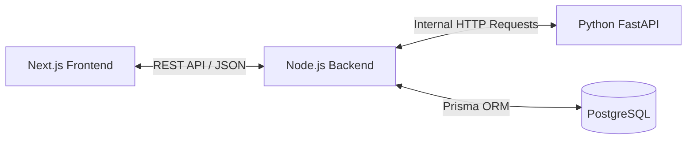

# 🏛 System Architecture & Security

This document outlines the architectural patterns, communication flows, security mechanisms, and physical folder structures used in the **Guidfy** project.

---

## 1. System Topology

Guidfy employs a **Distributed Services (Microservices-oriented) Architecture**. By decoupling the system into independent services, we achieve higher scalability, separation of concerns, and the ability to use the optimal technology for each specific domain.

The system is divided into three core tiers:
1. **Frontend Client (Next.js):** The presentation layer, responsible for SSR/CSR, routing, and UI rendering.
2. **Backend API (Node.js/Express):** The core business logic layer, acting as the primary gateway for the client. It handles database operations, authentication, and state management.
3. **AI Microservice (Python/FastAPI):** A specialized computing node strictly dedicated to executing Machine Learning models, generating career recommendations, and processing intensive data algorithms.

---

## 2. Communication Flow

The interaction between these services follows a strict, unidirectional data flow to ensure security and predictability:

- **Client ⟷ Backend API:** 
  The Next.js frontend communicates with the Node.js backend over HTTP/REST. The frontend acts as a consumer, sending user actions and fetching hydrated data for rendering.
- **Backend API ⟷ AI Service:** 
  The Node.js server communicates internally with the Python FastAPI service. When a user requests an AI-generated career report, the Node.js backend securely proxies this request to the Python service, waits for the processed result, stores it in the database, and returns it to the frontend.
- **Client ⟷ AI Service:** 
  *Strictly prohibited.* The frontend never communicates directly with the Python service. This isolates the AI service from public exposure and prevents unauthorized model execution.



---

## 3. Security Architecture

Security is baked into Guidfy at multiple layers, ensuring data integrity and strict access control.

### Authentication (JWT)
Guidfy uses **JSON Web Tokens (JWT)** for stateless authentication. 
- Upon successful login, the Node.js API issues a short-lived Access Token.
- All protected API routes require this token to be passed in the `Authorization` header as a Bearer token.
- Invalid, expired, or missing tokens automatically trigger a `401 Unauthorized` response.

### Role-Based Access Control (RBAC)
The system implements strict RBAC to segregate capabilities across three primary roles:
1. **USER:** Standard access. Can view learning paths, take quizzes, post in the community, and generate personal AI reports.
2. **ADMIN:** Elevated access. Assigned to specific communities or learning paths. Can moderate content, review projects, and manage assigned roadmaps.
3. **SUPER_ADMIN:** Supreme access. Full control over all system entities, user management, and global analytics.

### AI Service Security
Because the AI Service requires significant computational resources, it is heavily protected:
- **Internal Networking:** The FastAPI service is configured to accept traffic *only* from the Node.js backend's IP address.
- **Stateless Execution:** The Python service does not connect to the primary database. It receives raw JSON payloads from Node.js, processes them, and returns predictions. This limits the attack surface if the AI service were ever compromised.

---

## 4. Folder Structure Layout

The project is structured into logical repositories/folders to maintain clarity for developers.

```text
c:\final-project\
│
├── guidfy/                     # 🌐 NEXT.JS FRONTEND
│   ├── app/                    # App Router (Pages, Layouts, API Routes)
│   │   ├── admin/              # Admin dashboard workflows
│   │   ├── super-admin/        # Super-admin dashboard workflows
│   │   ├── community/          # Community feed and Q&A pages
│   │   ├── learning-paths/     # Student learning path pages
│   │   └── components/         # Reusable React components (UI, Forms, Modals)
│   ├── services/               # API caller functions (Axios/Fetch wrappers)
│   └── tailwind.config.js      # Global styling definitions
│
├── backend/                    # ⚙️ NODE.JS BACKEND
│   ├── ai_service/             # 🧠 PYTHON FASTAPI SERVICE
│   │   ├── main.py             # FastAPI entry point
│   │   ├── predict.py          # ML Inference logic
│   │   ├── retrain.py          # Model retraining logic
│   │   └── requirements.txt    # Python dependencies
│   │
│   ├── controllers/            # Express route controllers (Business logic)
│   ├── middleware/             # Express middlewares (Auth, Error handling)
│   ├── prisma/                 # Database schema and seeders
│   ├── routes/                 # Express API route definitions
│   └── server.js               # Node.js entry point
│
└── docs/                       # 📚 PROJECT DOCUMENTATION
    ├── ARCHITECTURE.md
    ├── DATABASE_SCHEMA.md
    ├── API_REFERENCE.md
    └── FEATURES.md
```

> [!TIP]
> **Developer Note**
> When working on full-stack features, always define your Prisma models in `backend/prisma/` first, expose the route in `backend/routes/`, and finally consume it in `guidfy/services/`.
